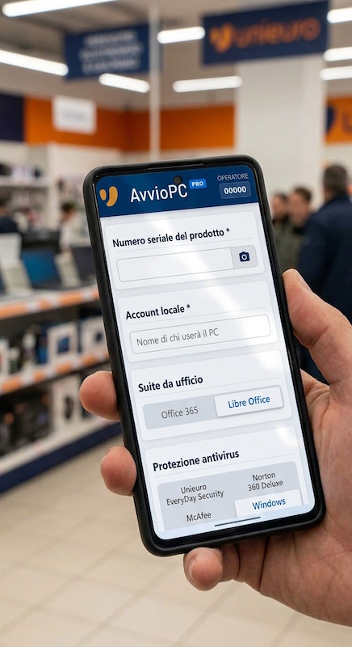
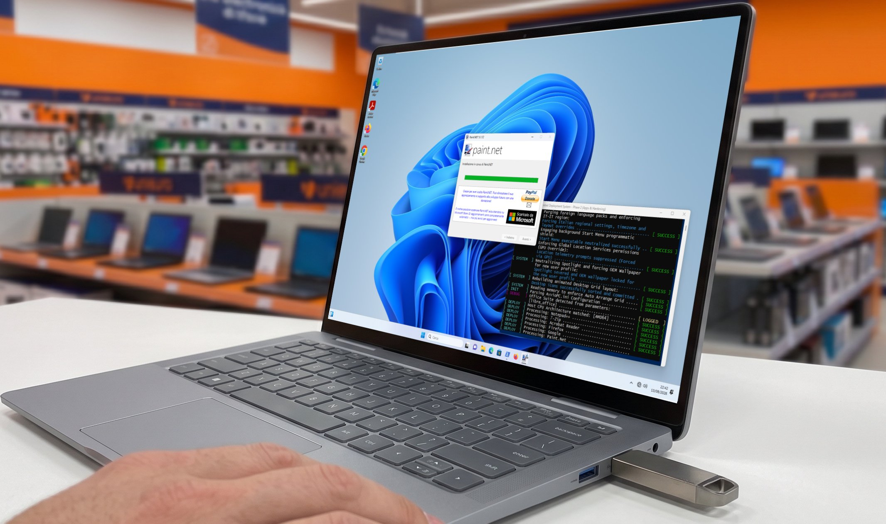
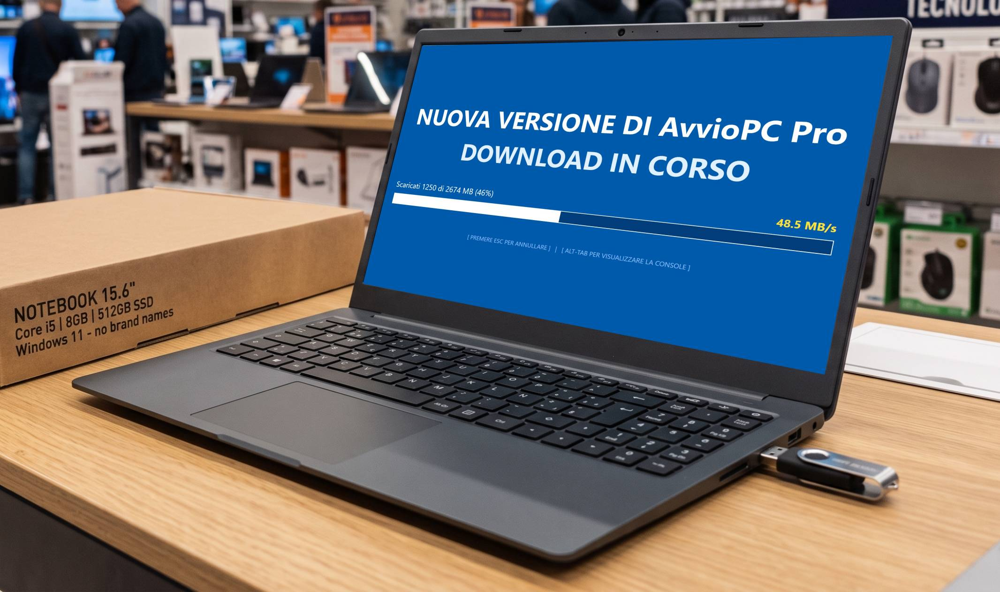
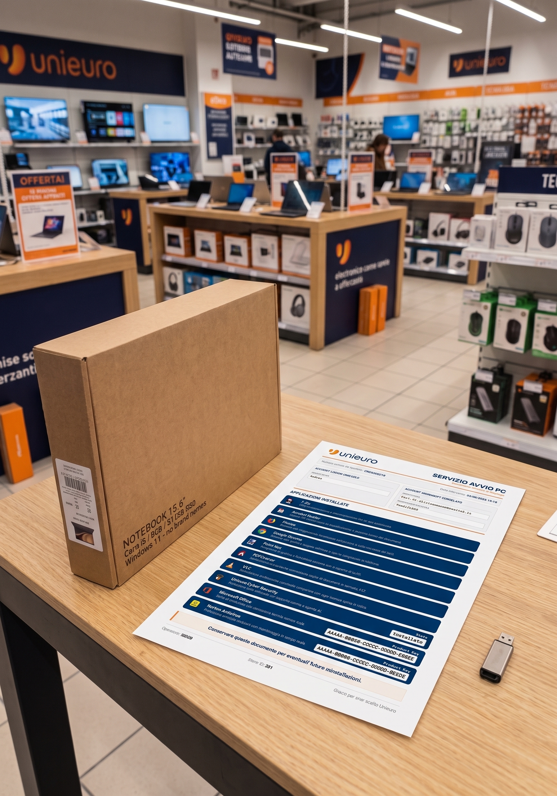

# AvvioPC Pro

AvvioPC Pro prepara da solo i PC che vendiamo con il servizio "pronto all'uso": installazione di Windows, programmi, account Microsoft, Office e antivirus. L'operatore registra i dati del cliente dallo smartphone, inserisce una chiavetta nel PC e lo accende. Il resto lo fa la chiavetta.

È il seguito del vecchio AvvioPC, uno script batch nato circa quattro anni fa per installare i programmi senza doverli scaricare ogni volta. Funzionava, ma molte cose restavano a mano: le schermate iniziali di Windows, l'antivirus, Office. E non tutti in negozio avevano il tempo o la pratica per farle. AvvioPC Pro serve a togliere questi passaggi.

Il sistema ha tre parti:

<table align="center">
  <thead>
    <tr><th align="left">Parte</th><th align="left">Dove si usa</th><th align="left">Cosa fa</th></tr>
  </thead>
  <tbody>
    <tr><td align="left">Web app</td><td align="left">Smartphone dell'operatore</td><td align="left">Registra seriale, account Microsoft e licenze del cliente</td></tr>
    <tr><td align="left">Chiavetta USB</td><td align="left">PC da preparare</td><td align="left">Configura Windows e installa tutto senza interventi</td></tr>
    <tr><td align="left">Demone di stampa</td><td align="left">Un PC del banco servizi</td><td align="left">Stampa il riepilogo da consegnare al cliente</td></tr>
  </tbody>
</table>

## Ultimi aggiornamenti

<!-- AVVIOPC_NEWS_START -->

**25/11/2026**
- Fase 3: la ricerca della rete Wi-Fi viene ripetuta per 45 secondi (prima era una sola e, se non trovava la rete, la fase 3 proseguiva senza internet).
- Account Microsoft con passkey: lo script sceglie da solo l'accesso con password. Il suo log ora resta nella cartella dei log e arriva su Drive.
- Corretto il messaggio "CONSEGNA ANCORA SOSPESA" che ricompariva a ogni accesso anche senza antivirus dimostrativo installato, quando la consegna era stata sospesa per l'account Microsoft.
- Importante: con gli ultimi aggiornamenti di Microsoft Defender la fase 3 veniva bloccata appena partita (falso allarme "Trojan LummaStealzer"), quindi niente account, Office e antivirus. Corretto: le esclusioni di Defender ora le aggiunge uno script separato.

**22/11/2026**
- Wi-Fi corretto sui PC ARM: la rete viene trovata già prima del primo accesso, senza passaggi manuali
- Antivirus dimostrativo: se la rimozione automatica fallisce, MCPR si apre guidato fino al captcha e il PC non viene dato per pronto finché non è rimosso
- Firewall riaperto e controllato a inizio fase 3, con verifica della navigazione
- Consegna sospesa (finestra rossa) se qualcosa non è a posto, con pulizia finale automatica al riavvio
- Console più ordinata: niente titolo doppio, dimensione adatta allo schermo
- Log salvati in automatico (senza dati personali) per l'analisi dei problemi

<!-- AVVIOPC_NEWS_END -->

## 1. La web app

Si apre dal browser dello smartphone (Android o iPhone) e si può aggiungere alla schermata Home come un'app. Si usa al banco, con il cliente presente, prima di andare in cassa.

- **Seriale del PC:** si legge il codice a barre con la fotocamera.
- **Licenze:** il product key di Office o dell'antivirus si legge dalla scheda con la fotocamera (OCR), senza ricopiarlo.
- **Account Microsoft:** la web app propone indirizzo e password per il nuovo account. Microsoft manda un PIN di verifica all'email del cliente: per questo il cliente deve essere presente.
- **Seriale abilitato:** dopo la registrazione il seriale resta abilitato per 24 ore. In questo tempo la chiavetta può scaricare i dati di quel PC.

I dati restano salvati. Se un PC torna in negozio per un problema o per un ripristino, la chiavetta lo riconosce dal seriale e lo rifà da capo.

## 2. La chiavetta USB

La chiavetta si crea e si aggiorna con un piccolo installer, da lanciare su un qualsiasi PC collegato a Internet (va bene anche un PC in esposizione).

Come si usa: si collega l'alimentatore, si inserisce la chiavetta e si accende il PC. Da qui in avanti:

- **Prima accensione:** la chiavetta salta le schermate iniziali di Windows, si collega al Wi-Fi del negozio, legge il seriale e scarica i dati registrati con la web app. Crea l'utente del cliente, senza password, e lo fa accedere da solo.
- **Programmi:** installa i programmi della tabella qui sotto, nella versione giusta per il processore del PC (Intel/AMD oppure ARM).
- **Account e licenze:** collega a Windows l'account Microsoft del cliente, prepara Office con il codice registrato e installa l'antivirus acquistato (Unieuro Everyday Digital, Norton 360 o McAfee).
- **Antivirus dimostrativo:** lo rimuove. Se la rimozione automatica non riesce, apre lo strumento di rimozione del produttore e lo porta avanti da solo fino al captcha, che va scritto a mano. Finché l'antivirus dimostrativo è sul PC, il PC non viene dato per pronto.
- **Windows Update:** installa gli aggiornamenti quando servono.
- **Controllo finale:** se qualcosa non è a posto (antivirus dimostrativo ancora presente, connessione bloccata, account da verificare) compare una finestra rossa "PC non pronto per la consegna". Se è tutto a posto il PC si riavvia ed è pronto.

Durante il lavoro una finestra in basso a destra mostra cosa sta facendo, una riga per passaggio. A fine lavoro i log vengono inviati in automatico, senza dati personali, così i problemi si possono analizzare anche quando in negozio non c'è tempo di salvarli.

**Aggiornamenti:** a fine lavoro la chiavetta controlla se c'è un pacchetto nuovo e lo scarica da sola. Se c'è una consegna urgente si può saltare il controllo. Questi sono i programmi installati e le versioni attuali:

<!-- AVVIOPC_VERSIONS_START -->

<table align="center" style="width: 100%; max-width: 800px; margin: 0 auto; border-collapse: collapse; font-family: -apple-system, BlinkMacSystemFont, Segoe UI, Helvetica, Arial, sans-serif; text-align: left;">
  <thead>
    <tr style="background-color: #f6f8fa;">
      <th align="left" style="padding: 12px; border: 1px solid #d0d7de; font-weight: 600; width: 70%;">Software</th>
      <th align="left" style="padding: 12px; border: 1px solid #d0d7de; font-weight: 600; width: 30%;">Versione</th>
    </tr>
  </thead>
  <tbody>
    <tr>
      <td align="left" style="padding: 10px 12px; border: 1px solid #d0d7de;">7-Zip</td>
      <td align="left" style="padding: 10px 12px; border: 1px solid #d0d7de; font-family: monospace;">v26.06</td>
    </tr>
    <tr>
      <td align="left" style="padding: 10px 12px; border: 1px solid #d0d7de;">Acrobat Reader</td>
      <td align="left" style="padding: 10px 12px; border: 1px solid #d0d7de; font-family: monospace;">v26.003.22110</td>
    </tr>
    <tr>
      <td align="left" style="padding: 10px 12px; border: 1px solid #d0d7de;">AutoHotkey</td>
      <td align="left" style="padding: 10px 12px; border: 1px solid #d0d7de; font-family: monospace;">v2.0.32</td>
    </tr>
    <tr>
      <td align="left" style="padding: 10px 12px; border: 1px solid #d0d7de;">Firefox</td>
      <td align="left" style="padding: 10px 12px; border: 1px solid #d0d7de; font-family: monospace;">v161.0</td>
    </tr>
    <tr>
      <td align="left" style="padding: 10px 12px; border: 1px solid #d0d7de;">Google Chrome</td>
      <td align="left" style="padding: 10px 12px; border: 1px solid #d0d7de; font-family: monospace;">v159.0.8154.34</td>
    </tr>
    <tr>
      <td align="left" style="padding: 10px 12px; border: 1px solid #d0d7de;">LibreOffice</td>
      <td align="left" style="padding: 10px 12px; border: 1px solid #d0d7de; font-family: monospace;">v26.8.3</td>
    </tr>
    <tr>
      <td align="left" style="padding: 10px 12px; border: 1px solid #d0d7de;">McAfee Removal Tool</td>
      <td align="left" style="padding: 10px 12px; border: 1px solid #d0d7de; font-family: monospace;">Ultima release CDN</td>
    </tr>
    <tr>
      <td align="left" style="padding: 10px 12px; border: 1px solid #d0d7de;">Microsoft WebView2 Runtime</td>
      <td align="left" style="padding: 10px 12px; border: 1px solid #d0d7de; font-family: monospace;">vThu19Nov2026212139GMT</td>
    </tr>
    <tr>
      <td align="left" style="padding: 10px 12px; border: 1px solid #d0d7de;">Norton Removal Tool</td>
      <td align="left" style="padding: 10px 12px; border: 1px solid #d0d7de; font-family: monospace;">Ultima release CDN</td>
    </tr>
    <tr>
      <td align="left" style="padding: 10px 12px; border: 1px solid #d0d7de;">Notepad++</td>
      <td align="left" style="padding: 10px 12px; border: 1px solid #d0d7de; font-family: monospace;">v8.9.9.1</td>
    </tr>
    <tr>
      <td align="left" style="padding: 10px 12px; border: 1px solid #d0d7de;">Paint.Net</td>
      <td align="left" style="padding: 10px 12px; border: 1px solid #d0d7de; font-family: monospace;">v5.2</td>
    </tr>
    <tr>
      <td align="left" style="padding: 10px 12px; border: 1px solid #d0d7de;">PDF24</td>
      <td align="left" style="padding: 10px 12px; border: 1px solid #d0d7de; font-family: monospace;">v11.35.0</td>
    </tr>
    <tr>
      <td align="left" style="padding: 10px 12px; border: 1px solid #d0d7de;">Unieuro Everyday Digital</td>
      <td align="left" style="padding: 10px 12px; border: 1px solid #d0d7de; font-family: monospace;">Ultima release CDN</td>
    </tr>
    <tr>
      <td align="left" style="padding: 10px 12px; border: 1px solid #d0d7de;">VLC</td>
      <td align="left" style="padding: 10px 12px; border: 1px solid #d0d7de; font-family: monospace;">v3.0.24</td>
    </tr>
  </tbody>
</table>

<em>Dati aggiornati alle 10:16 del 25/11/2026</em>

<!-- AVVIOPC_VERSIONS_END -->

## 3. Il demone di stampa

È un piccolo programma che si installa su un PC del negozio collegato alla rete. Non servono i privilegi di amministratore. Parte da solo all'accesso a Windows, resta come icona vicino all'orologio e si aggiorna da solo.

Quando i dati di un PC sono pronti, stampa un foglio di riepilogo: cosa è stato installato, l'account Microsoft, le licenze. Il foglio si consegna al cliente insieme al PC, così sa cosa è stato fatto e ha i suoi dati di accesso.

---

> **Chi lo fa**
> AvvioPC Pro lo scrivo da solo, nel tempo libero e senza compenso. Non ho licenze di prova dei programmi commerciali, quindi alcune parti (Office, antivirus) le posso controllare solo sui PC veri. Gli aggiornamenti li annuncio nel gruppo WhatsApp di supporto: se qualcosa non va, scrivetemi lì. Nato in negozio, da commesso, per i commessi.

## Demo

[QR Code Signature Demo](https://api.qrserver.com/v1/create-qr-code/?size=200x200&data=https://avviopcpro.github.io/AvvioPCPro/firma-demo.html?v=5.2)
