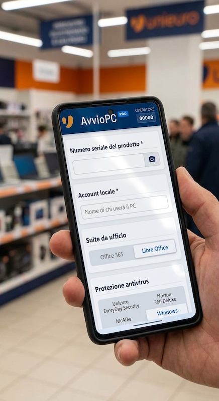
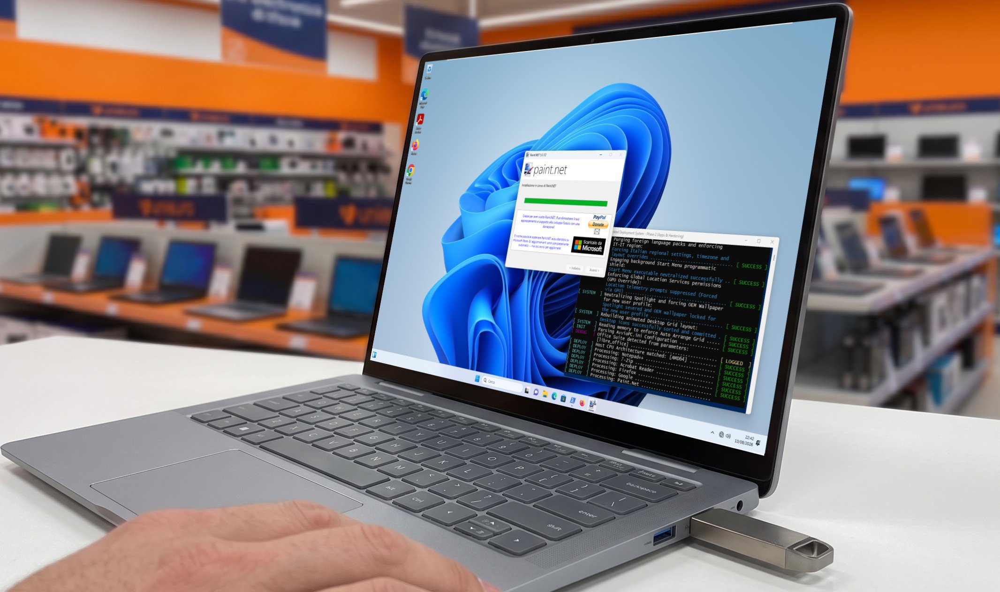
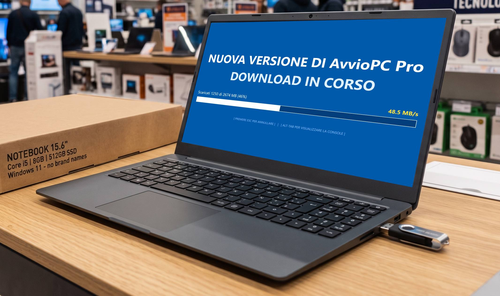
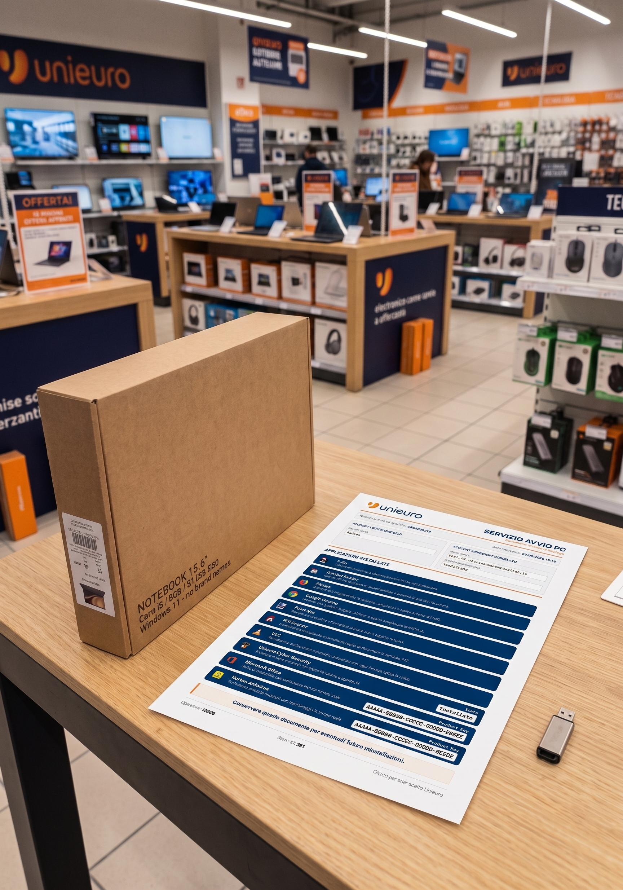

# **AvvioPC Pro: la nuova era del deployment**

**AvvioPC Pro** rappresenta l'evoluzione definitiva del primordiale *AvvioPC*, nato originariamente come un semplice script DOS per configurare computer in ambito retail. L'obiettivo di quel piccolo script era di superare le limitazioni di pacchetti commerciali come Ninite o Chocolatey, prima fra tutte la necessità di lunghi download per l'installazione degli applicativi.

La rustica semplicità del primo *AvvioPC* ha rappresentato anche il suo più grande limite: l'avvento di nuovi software da installare, l'assenza di funzioni di aggiornamento automatico o di reportistica integrata e -soprattutto- la necessità di eseguire manualmente molti passaggi (OOBE, antivirus, Office), secondo procedure che non tutti gli addetti vendita erano preparati a fare, ne hanno decretato il lento ma inesorabile declino.

Per tutte queste ragioni è stato concepito l'ecosistema **AvvioPC Pro**, un installer definitivo e professionale, strutturato su tre moduli perfettamente integrati.

L'adozione di questa nuova suite trasforma radicalmente l'operatività dell'area IT: l'automazione spinta azzera i tempi morti e i colli di bottiglia tecnici, garantendo un incremento immediato della produttività. Tutto questo si traduce in una drastica riduzione dei costi occulti di configurazione e in un servizio al cliente impeccabile, elevando gli standard qualitativi e l'efficienza dell'intera area vendita.

| Modulo operativo | Piattaforma target | Obiettivo strategico e funzioni  chiave |
| :--- | :--- | :--- |
| **1. web app front-end** | Smartphone / Mobile Browser | Barcode scanner per S/N, OCR per product key, Generazione MSA & PIN client-side |
| **2. USB zero-touch** | Notebook / PC in lavorazione | Bypass OOBE, provisioning offline, installazione silent app & AV, auto-update Cloudflare |
| **3. Demone di stampa** | PC in rete / Banco Servizi | Ricezione job da server, generazione automatica e stampa del report di livello professionale |

## **1. Il centro di controllo: una web app di front-end**

Il fulcro operativo dell'interazione con il commesso è un'applicazione web PWA installabile su qualsiasi smartphone (Android o iOS), concepita per essere utilizzata in mobilità e in presenza del cliente prima del passaggio in cassa.

* **Acquisizione dati avanzata:** E' stato implementato un lettore barcode tramite fotocamera per associare istantaneamente il serial number (S/N) del PC. Sono altresì presenti moduli OCR per acquisire i product key delle licenze ed iniettarli in modalità totalmente *unattended* durante il provisioning.
* **Gestione account Microsoft (MSA):** E' presente un algoritmo di generazione automatizzata delle credenziali per i nuovi account MSA. L'operatività in presenza del cliente si rivela strategica e indispensabile per ricevere e confermare in tempo reale il PIN di verifica inviato da Microsoft sullo smartphone dell'utente.

## **2. L'esecutore silente: una chiavetta USB zero-touch**

Il vero motore dell'automazione sul campo è la chiavetta USB di servizio. Il supporto si genera e si aggiorna tramite un web Installer dedicato, quest'ultimo scaricabile ed installabile su un qualsiasi PC connesso ad Internet, ad esempio un notebook in esposizione.

* **Configurazione automatica zero-touch:** È sufficiente collegare l'alimentazione al computer da configurare, inserire la chiavetta USB e accendere la macchina per saltare a piè pari tutte le innumerevoli schermate OOBE di Microsoft Windows 11.
* **Provisioning offline integrato:** Il sistema esegue la disinstallazione pulita degli antivirus dimostrativi e procede all'installazione *unattended* della suite di applicazioni predefinite. Inietta l'account Microsoft precedentemente creato, gestisce l'attivazione di Microsoft Office, e configura l'antivirus commerciale selezionato (Unieuro Everyday Digital, Norton 360 o McAfee), forzando all'occorrenza gli aggiornamenti via Windows Update.
* **Sincronizzazione via cloud autoaggiornante:** Al termine delle lavorazioni, il software verifica la presenza di nuove release del pacchetto sui server Cloudflare R2 e scarica autonomamente gli aggiornamenti (questa funzionalità prevede un bypass rapido in caso di consegne urgenti). Questo l'elenco dei programmi supportati e delle versioni attualmente installate:

<!-- AVVIOPC_VERSIONS_START -->

<table style="width: 100%; max-width: 800px; margin: 0 auto; border-collapse: collapse; font-family: -apple-system, BlinkMacSystemFont, Segoe UI, Helvetica, Arial, sans-serif; text-align: left;">
  <thead>
    <tr style="background-color: #f6f8fa;">
      <th style="padding: 12px; border: 1px solid #d0d7de; font-weight: 600; width: 70%;">Software</th>
      <th style="padding: 12px; border: 1px solid #d0d7de; font-weight: 600; width: 30%;">Versione</th>
    </tr>
  </thead>
  <tbody>
    <tr>
      <td style="padding: 10px 12px; border: 1px solid #d0d7de;">7-Zip</td>
      <td style="padding: 10px 12px; border: 1px solid #d0d7de; font-family: monospace;">v26.05</td>
    </tr>
    <tr>
      <td style="padding: 10px 12px; border: 1px solid #d0d7de;">Acrobat Reader</td>
      <td style="padding: 10px 12px; border: 1px solid #d0d7de; font-family: monospace;">v26.002.22031</td>
    </tr>
    <tr>
      <td style="padding: 10px 12px; border: 1px solid #d0d7de;">AutoHotkey</td>
      <td style="padding: 10px 12px; border: 1px solid #d0d7de; font-family: monospace;">v2.0.31</td>
    </tr>
    <tr>
      <td style="padding: 10px 12px; border: 1px solid #d0d7de;">Firefox</td>
      <td style="padding: 10px 12px; border: 1px solid #d0d7de; font-family: monospace;">v159.0</td>
    </tr>
    <tr>
      <td style="padding: 10px 12px; border: 1px solid #d0d7de;">Google Chrome</td>
      <td style="padding: 10px 12px; border: 1px solid #d0d7de; font-family: monospace;">v157.0.8103.27</td>
    </tr>
    <tr>
      <td style="padding: 10px 12px; border: 1px solid #d0d7de;">LibreOffice</td>
      <td style="padding: 10px 12px; border: 1px solid #d0d7de; font-family: monospace;">v26.8.1</td>
    </tr>
    <tr>
      <td style="padding: 10px 12px; border: 1px solid #d0d7de;">McAfee Removal Tool</td>
      <td style="padding: 10px 12px; border: 1px solid #d0d7de; font-family: monospace;">Ultima release CDN</td>
    </tr>
    <tr>
      <td style="padding: 10px 12px; border: 1px solid #d0d7de;">Norton Removal Tool</td>
      <td style="padding: 10px 12px; border: 1px solid #d0d7de; font-family: monospace;">Ultima release CDN</td>
    </tr>
    <tr>
      <td style="padding: 10px 12px; border: 1px solid #d0d7de;">Notepad++</td>
      <td style="padding: 10px 12px; border: 1px solid #d0d7de; font-family: monospace;">v8.9.8.1</td>
    </tr>
    <tr>
      <td style="padding: 10px 12px; border: 1px solid #d0d7de;">Paint.Net</td>
      <td style="padding: 10px 12px; border: 1px solid #d0d7de; font-family: monospace;">v5.1.12</td>
    </tr>
    <tr>
      <td style="padding: 10px 12px; border: 1px solid #d0d7de;">PDF24</td>
      <td style="padding: 10px 12px; border: 1px solid #d0d7de; font-family: monospace;">v11.31.1</td>
    </tr>
    <tr>
      <td style="padding: 10px 12px; border: 1px solid #d0d7de;">Unieuro Everyday Digital</td>
      <td style="padding: 10px 12px; border: 1px solid #d0d7de; font-family: monospace;">Ultima release CDN</td>
    </tr>
    <tr>
      <td style="padding: 10px 12px; border: 1px solid #d0d7de;">VLC</td>
      <td style="padding: 10px 12px; border: 1px solid #d0d7de; font-family: monospace;">v3.0.24</td>
    </tr>
  </tbody>
</table>

<em>Dati aggiornati alle 01:56 del 29/10/2026</em>

<!-- AVVIOPC_VERSIONS_END -->

* **Diagnostica e telemetria visiva:** Una finestra di console monitora l'avanzamento registrando ogni evento in appositi file di log. Eventuali interruzioni o anomalie vengono prontamente segnalate tramite maxi-banner visivi ad alto contrasto, leggibili anche a grande distanza nell'area di lavoro.

## **3. La prova tangibile: un "demone" di stampa**

A chiudere l'architettura della suite interviene un'utility (tecnicamente chiamata "demone") residente nella tray bar e autoaggiornante. E' facilmente installabile su un qualsiasi computer connesso alla rete locale del negozio.

* **Flusso di Lavoro asincrono:** Il demone lavora in background e in modo del tutto silente, rimanendo in ascolto delle chiamate provenienti dalla web app.
* **Generazione automatica:** Non appena i dati di configurazione vengono caricati in cloud, il demone elabora le informazioni e manda automaticamente in stampa un report dettagliato, elegante e professionale.
* **Trasparenza verso il cliente:** Tale report è concepito per essere consegnato al cliente al momento del ritiro, fornendo una prova tangibile, chiara e trasparente di tutte le attività tecniche svolte sul suo computer.

---

> **▲ Note di sviluppo & filosofia progettuale:**
> Questo software è stato scritto dall'autore a titolo completamente gratuito e senza fini di lucro. Limitazioni nell'installazione di software commerciale derivano dall'impossibilità di acquistare a proprie spese licenze di test, costringendo a verifiche direttamente in produzione. Nonostante queste limitazioni, si è comunque cercato di realizzare un prodotto di livello professionale, robusto e dall'utilizzo intuitivo. Un prodotto nato e pensato direttamente sul campo... **da commesso, per i commessi**.

## Demo area
[QR Code Signature Demo](https://api.qrserver.com/v1/create-qr-code/?size=200x200&data=https://avviopcpro.github.io/AvvioPCPro/firma-demo.html?v=5.2)
